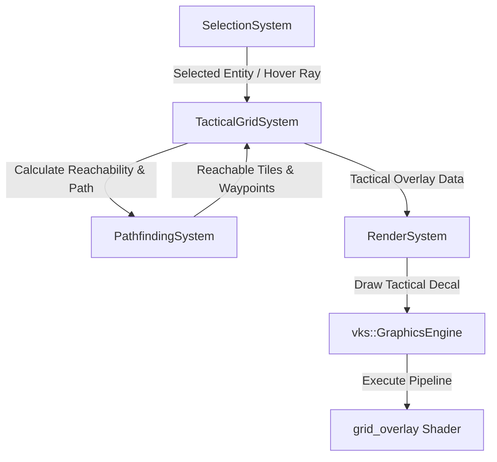

# Requirements

### Overview & Goals
Provide in-game tactical grid visualization inspired by XCOM 2 for the pathfinding system using Vulkan (`vks`). When a pathfinding agent is selected, players see a procedural holographic grid displaying reachable movement bounds (based on the agent's `movementAllowance`), the active tile cursor, and a projected path trajectory to the hovered destination.

### Scope
#### In Scope
- **Reachable Movement Range**: Dijkstra-based reachability calculation for the selected agent constrained by `movementAllowance` and barrier traversal costs.
- **Procedural Decal Grid Rendering**: Vulkan pipeline and GLSL fragment shader rendering anti-aliased grid lines, reachable tile zones, and dynamic holographic pulsing over walkable terrain.
- **Hover Path Trajectory**: Interactive preview path line projecting from the agent to the cursor tile on mouse hover.
- **ECS Integration**: `TacticalGridSystem` interfacing between `SelectionSystem`, `PathfindingSystem`, and `RenderSystem`.

#### Out of Scope
- Full combat UI (weapon ranges, cover shield icons, hit percentages, action camera cutscenes).
- Multi-layer vertical climbing / ladder voxel navigation overlays.

### User Stories
- As a player, when I select a unit, I want to see the area the unit can reach in one move highlighted on the ground so I can make tactical positioning decisions.
- As a player, when I hover the mouse over a target tile, I want to see the projected path and movement cost so I know the route my unit will take before confirming.

### Functional Requirements
- **Selection Triggering**: Tactical grid visualization activates when an entity with `PathfindingAgent` is selected in `SelectionSystem` and hides when deselected.
- **Range Boundaries**: Reachable cells within `movementAllowance` are rendered with a distinct tactical glow and sharp outer boundary.
- **Path Preview**: Moving the mouse over reachable cells updates a projected path ribbon from the agent's position to the hovered tile.
- **Multi-size Agent Support**: Correctly renders range footprints and path alignments for both size-1 and multi-cell agents (e.g., size-2 chunk centering).
- **Smooth Antialiasing**: Grid lines and range edges remain crisp across zoom levels and camera angles using analytical shader derivatives (`fwidth`).

### Non-Functional Requirements
- **Performance**: Procedural decal shader evaluated over bounding geometry minimizes draw calls to $O(1)$ per grid fragment/zone rather than rendering thousands of individual quad meshes.
- **Visual Clarity**: High contrast between walkable, reachable, and obstructed terrain with depth awareness and subtle time-based animations.

# Technical Design

### Current Implementation
- `PathfindingSystem`: Manages navigation grid data (`GridFragment`), obstacle blocking, edge barriers, size-aware coordinate conversions (`WorldToGrid`, `GridToWorld`), and A* path queries (`FindPathGrid`, `FindPath`) with `movementAllowance` limits.
- `SelectionSystem`: Raycasts from camera screenspace to select entities and trigger `RequestPath`.
- `RenderSystem` & `vks`: Coordinates `GraphicsEngine` frame submissions, camera uniforms, models, and materials via Vulkan pipelines.
- `GridFragmentGizmoVisualizer`: Draws editor debug lines via ImGui, but no in-game procedural Vulkan shader visualization exists yet.

### Key Decisions
- **Procedural Decal Shader over Quad Batching**: Uses procedural world-space fragment shading on terrain bounding decals rather than per-tile instanced meshes. This delivers optimal Vulkan performance, continuous antialiasing, and simple uniform parameter updates.
- **Dijkstra Range Computation in Pathfinding**: Introduces a dedicated Dijkstra flood-fill query in `PathfindingSystem` caching reachable tile costs whenever an agent is selected or navigation grid updates occur.
- **Alpha-Blended Tactical Overlay Pipeline**: Uses a dedicated translucent blend state (`VK_BLEND_FACTOR_SRC_ALPHA`, `VK_BLEND_FACTOR_ONE_MINUS_SRC_ALPHA`) with depth testing enabled and depth writing disabled to prevent z-fighting against terrain geometry.

### Proposed Changes
- **Pathfinding & Reachability Query**:
  - Add `CalculateReachableCells(startGrid, agentSize, maxCost)` in `PathfindingSystem` returning a map/set of reachable `glm::ivec2` coordinates and cumulative costs.
- **Tactical Grid System (`TacticalGridSystem`)**:
  - New system listening to `SelectionSystem` and camera raycasts to update hover tile, calculate preview path, and manage decal geometry bounds.
- **Vulkan Procedural Grid Shaders (`grid_overlay.vert`, `grid_overlay.frag`)**:
  - Vertex shader passes world-space fragment coordinates and decal UVs.
  - Fragment shader computes analytical anti-aliased grid lines (`fwidth`), evaluates reachability masks, adds glowing border edges, and renders path line ribbons.
- **Render System Integration**:
  - Bind tactical overlay pipeline and submit decal draw calls during scene rendering.

### Data Models / Contracts
```cpp
struct ReachableCellInfo {
    glm::ivec2 gridPos;
    float traversalCost;
    bool isReachable;
};

struct TacticalOverlayPushConstant {
    glm::mat4 modelMatrix;
    glm::vec4 gridParams;     // x: cellSize, y: gridOriginX, z: gridOriginZ, w: time
    glm::vec4 rangeColor;     // rgba tactical highlight color
    glm::vec4 pathColor;      // rgba path ribbon color
    glm::ivec4 hoverParams;   // x: hoverGridX, y: hoverGridY, z: agentSize, w: pathLength
};
```

### File Structure
- `src/engine/systems/tacticalGridSystem/TacticalGridSystem.hpp` (New)
- `src/engine/systems/tacticalGridSystem/TacticalGridSystem.cpp` (New)
- `src/engine/systems/tacticalGridSystem/components/TacticalGridComponent.hpp` (New)
- `src/engine/systems/pathfindingSystem/PathfindingSystem.hpp` (Modified)
- `src/engine/systems/pathfindingSystem/PathfindingSystem.cpp` (Modified)
- `src/engine/systems/renderingSystem/RenderSystem.cpp` (Modified)
- `res/shaders/glsl/entry/grid_overlay.vert` (New)
- `res/shaders/glsl/entry/grid_overlay.frag` (New)
- `src/engine/tests/TacticalGridTest.cpp` (New)

### Architecture Diagram


### Risks
- **Terrain Z-Fighting**: Decal geometry coplanar with floor meshes can exhibit depth flickering. *Mitigation*: Apply a small normal offset or use polygon offset / depth bias in the Vulkan pipeline.
- **Large Grid Range Performance**: Large `movementAllowance` values could expand Dijkstra search volume. *Mitigation*: Bound Dijkstra exploration tightly with `maxCost` priority queue pruning and cache reachability per selection change.

# Testing

### Validation Approach
Automated testing and render validation verifying Dijkstra reachability math, multi-size agent footprint alignment, path preview bounds, and Vulkan pipeline execution.

### Key Scenarios
- **Reachable Zone Accuracy**: Agent with `movementAllowance = 4.0` generates a reachable cell set strictly satisfying cost bounds and respects barrier extra costs.
- **Hover Path Truncation**: Hovering over a tile beyond `movementAllowance` truncates the preview path at the maximum allowed traversal boundary.
- **Multi-size Footprint Alignment**: Size-2 agent displays range cells and hover paths centered on 2x2 chunk intersections without cell offset drift.
- **Selection State Transitions**: Selecting an agent activates the tactical grid; deselecting or issuing a move order cleanly dismisses or transitions the overlay.

### Edge Cases
- Agent enclosed by obstacles or impassable barriers (empty reachability set).
- Mouse raycast pointing outside all navigation grid fragments (graceful fallback with no invalid path rendering).
- Zero `movementAllowance` (unlimited movement mode versus fixed-step movement mode).

### Test Changes
- Add unit tests in `src/engine/tests/TacticalGridTest.cpp` testing `CalculateReachableCells`, hover path calculation, and tactical state lifecycle.
- Update `src/engine/tests/PathfindingTest.cpp` to validate range queries across barrier and obstacle configurations.

# Delivery Steps

### ✓ Step 1: Implement Tactical Reachability and Path Preview Data Models
`PathfindingSystem` and `TacticalGridSystem` calculate reachable tile sets (Dijkstra reachability within `movementAllowance`) and dynamic hover path trajectories.

- Implement `CalculateReachableCells(startGrid, agentSize, maxCost)` in `PathfindingSystem` using Dijkstra search taking cell traversal and barrier costs into account.
- Create `TacticalGridComponent` and `TacticalGridSystem` in `src/engine/systems/tacticalGridSystem/`.
- Maintain active tactical overlay state: selected entity, reachable tile set, hover grid coordinate, and preview path waypoints.
- Expose query functions for grid bounds, cell dimensions, and world-space decal plane transformations.

### ✓ Step 2: Develop Procedural Tactical Grid GLSL Shaders and Asset Descriptors
Procedural GLSL shaders render anti-aliased grid lines, movement range boundaries, and holographic path ribbons.

- Create `grid_overlay.frag` and `grid_overlay.vert` in `res/shaders/glsl/entry/`.
- Implement procedural anti-aliased cell borders using screen-space derivatives (`fwidth` / `smoothstep`) in world coordinates.
- Implement fragment shader routines to highlight reachable movement range zones and render projected path trajectories.
- Add asset metadata (`.meta`) and build configuration entries for SPIR-V compilation and pipeline descriptor generation.

### ✓ Step 3: Integrate Tactical Decal Rendering into Vulkan Graphics Pipeline
`RenderSystem` and `vks::VulkanRenderer` instantiate decal plane geometry and render procedural grid overlays with alpha blending.

- Register `grid_overlay` shader program and decal plane mesh handle in engine resource initialization.
- Configure alpha-blended pipeline state (depth test with depth-write disabled or decal offset) for tactical grid overlays in `RenderPipelineManager`.
- Update `RenderSystem::Update` to submit tactical decal render commands to `scene->engine.graphicsEngine->drawModel` when an agent is selected.
- Pass runtime tactical uniform parameters (grid origin, cell dimensions, reachability bounding extents, time pulse) via push constants / uniform buffers.

### ✓ Step 4: Wire Interactive Mouse Hover Path Preview and Selection System
Mouse hover raycasting calculates real-time path trajectories and updates tactical grid visuals dynamically.

- Connect `SelectionSystem` mouse raycast hit points to `TacticalGridSystem` to update the hovered grid cell.
- Dynamically compute preview paths from the selected agent to the hovered cell and clamp/truncate based on `movementAllowance`.
- Update tactical visual states immediately upon agent selection, deselection, or movement completion.

### ✓ Step 5: Add Automated Tests for Tactical Grid Reachability and Visualization Lifecycle
Automated unit tests verify reachability calculation accuracy, barrier cost integration, and visual state lifecycle.

- Add test suite `TacticalGridTestSuite` in `src/engine/tests/TacticalGridTest.cpp`.
- Verify Dijkstra reachability correctness for single-cell and multi-cell agents with open terrain and barrier impediments.
- Verify path preview truncation matching `movementAllowance` bounds and verify clean selection/deselection state transitions.