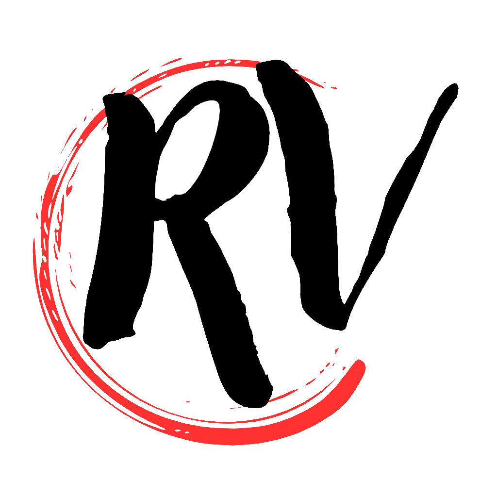

# ReasonableVulkan

My custom modular ECS game engine featuring bindless Vulkan rendering, a fully-featured editor, scripting with hot reloading, and native CLion integration.
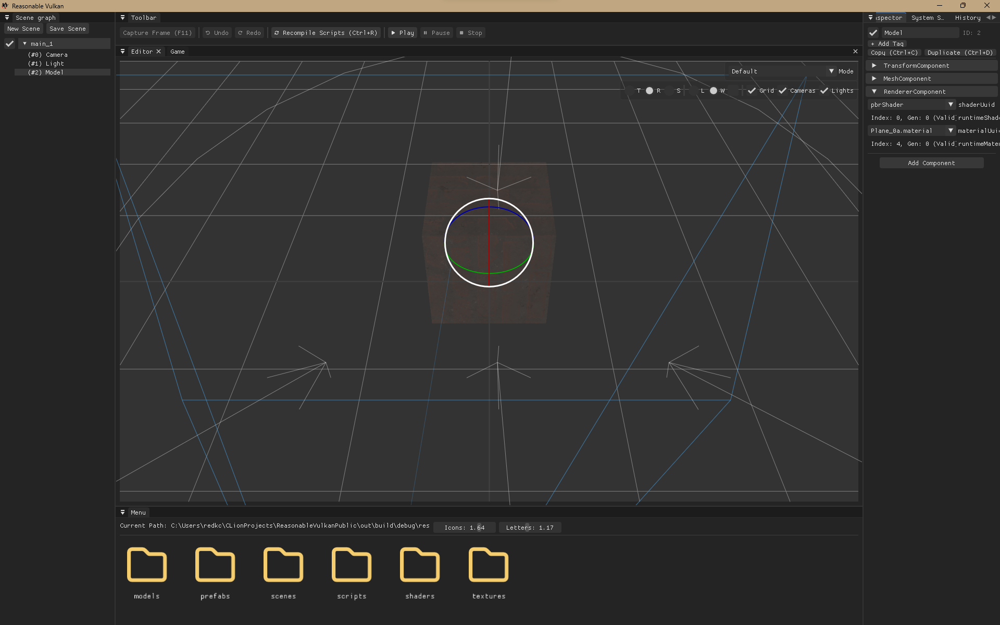

## Contents
- [Showcase](#showcase)
    - [Editor Functionality](#editor-functionality)
    - [Optimization & Performance](#optimization--performance)
    - [Testing & Profiling](#testing--profiling)
- [Installation](#installation)
    - [Prerequisites](#prerequisites)
    - [Build Presets](#build-presets)
    - [Notes](#notes)

---
## Showcase

### Editor Functionality
- **Hierarchical Scene Graph**: Intuitive entity hierarchy with transform inheritance across nested objects.
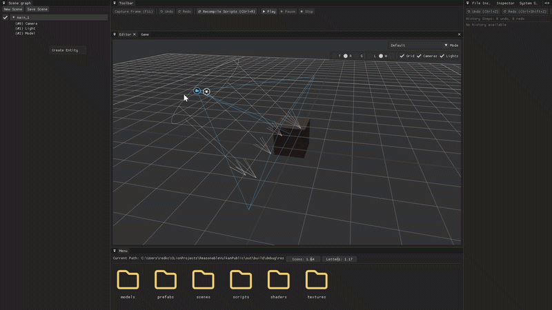
- **Integrated File Browser**: Fully functional asset browser for managing textures, models, shaders, and project resources.
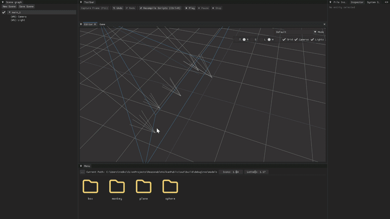
- **Undo / Redo System**: Command-based history supporting `Ctrl+Z` / `Ctrl+Y` actions across entity and scene modifications.
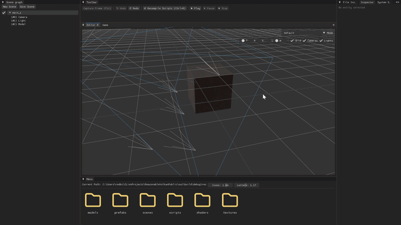
- **Multi-Scene & Prefabs**: Seamlessly switch between active scenes and instantiate reusable prefab templates.
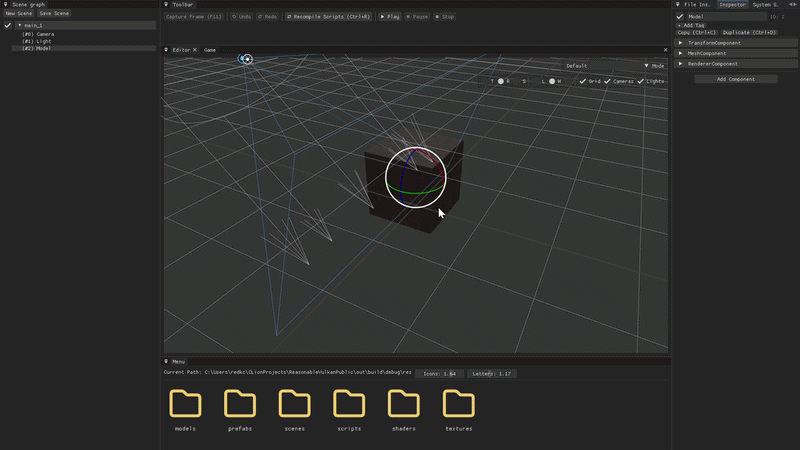
- **CLion Plugin Integration**: Direct IDE connection for synchronized workflows, project control, and development convenience.
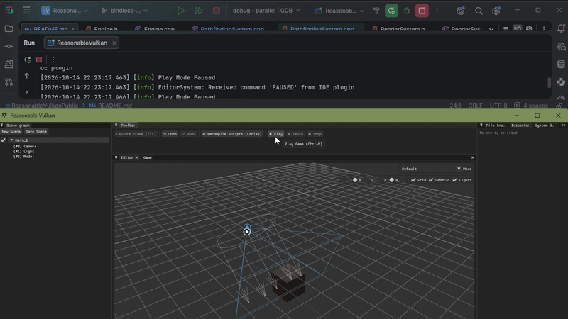
- **Scripting with Hot Reloading**: Rapid iteration via dynamic script reloading without restarting the engine.
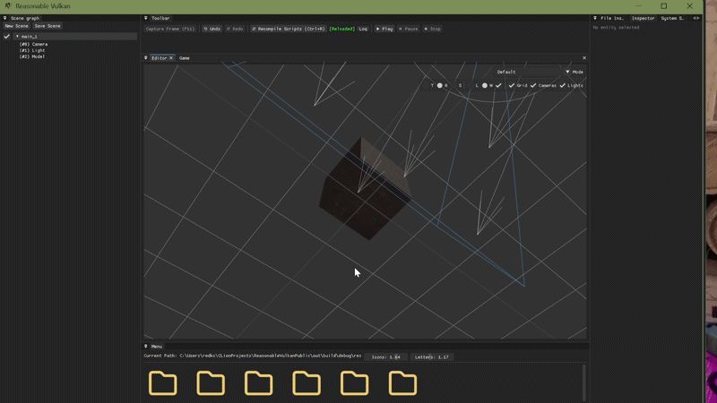

### Optimization & Performance
- **Bindless Vulkan Architecture**: High-throughput rendering with reduced CPU-GPU synchronization and flexible descriptor management.
- **High-Performance ECS**: Minimal-overhead Entity-Component-System architecture using cache-friendly contiguous component storage.
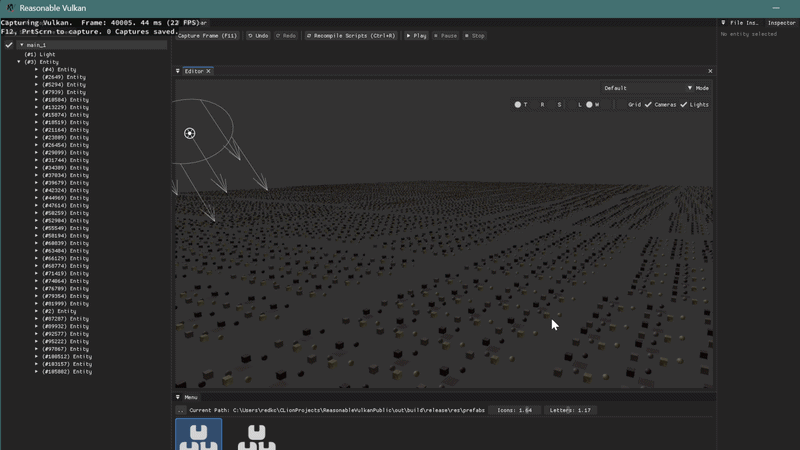
A high level of optimization and performance allows for scenes containing 100k separate entities with nine mesh+material variants and one directional light while still maintaining a stable 20+ FPS.
- **Fast Compilation Times**: Modular architecture and decoupled template implementations to minimize developer build times.
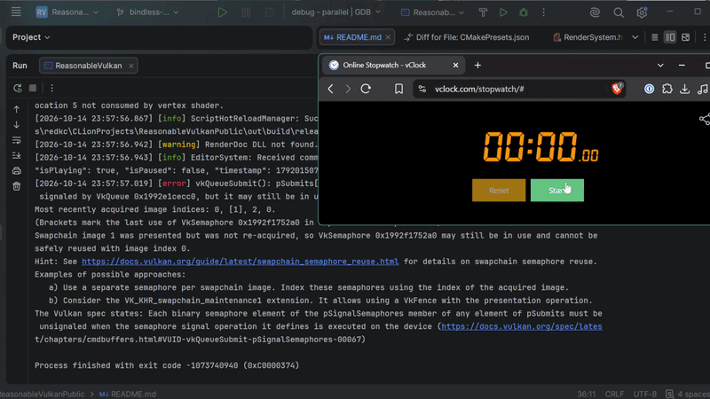
Allowing the build time of 30k+ lines of code in just above 30 seconds.
- **Custom Engine Asset Formats**: Streamlined binary formats and UUID-based caching for near-instant engine startup.
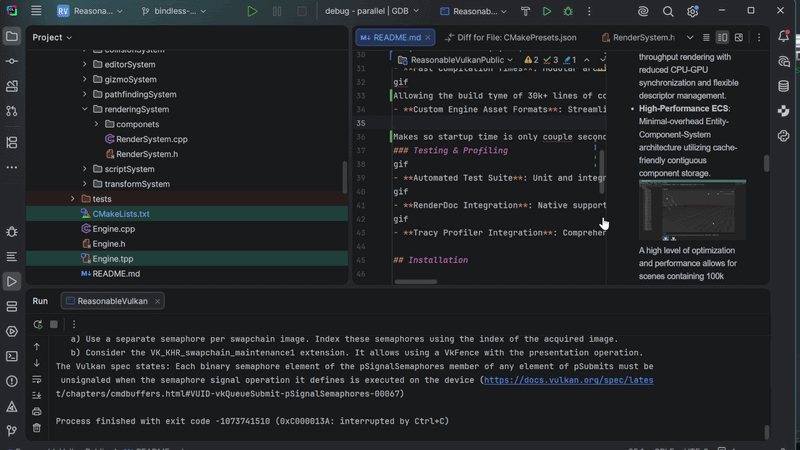
Makes so startup time is only a couple seconds.
### Testing & Profiling
gif
- **Automated Test Suite**: Unit and integration test coverage for core systems, ECS lifecycle, and asset management.
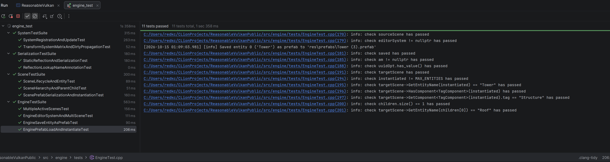
- **RenderDoc Integration**: Native support for in-depth Vulkan frame captures and graphics debugging.
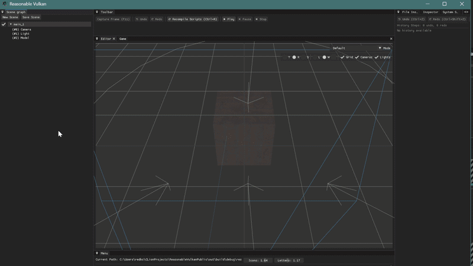
- **Tracy Profiler Integration**: Comprehensive real-time CPU/GPU performance tracing and frame budget analysis.

## Installation

---

### Prerequisites

Before you begin, make sure you have:

- **CMake ≥ 3.24** installed and added to your system PATH.
- **MinGW-w64** with `gcc`, `g++`, and `mingw32-make` in PATH. (other compilers may work but aren't actively used by me)
- **vcpkg** installed and the environment variable `VCPKG_ROOT` set to your vcpkg directory.
- **Vulkan SDK** installed and added to PATH

### Build Presets

This project uses CMake presets to simplify configuration. Presets are defined in `CMakePresets.json`.

Available presets:

- ``debug`` — Debug build without tests
- ``debug-with-tests`` — Debug build with unit and integration tests
- ``release`` — Optimized release build

### Notes

-----

- After build, a symbolic link to the ``res/`` folder is created in the build directory.
- Implicit Vulkan layers are disabled via `VK_LOADER_LAYERS_DISABLE=~implicit~` in CMake presets because they caused Vulkan validation layers to crash.
- There is a plugin available for Clion here: https://github.com/ReasonPsycho/ReasonableVulkanPlugin